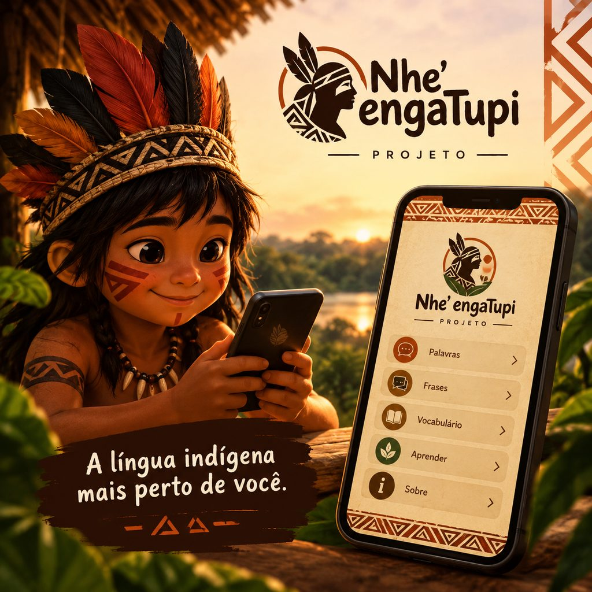

<!--
Projeto acadêmico Nhe’engaTupi
Documentação organizada por áreas, mantendo os artefatos originais e seu histórico.
-->

<p align="center">
  
</p>

<h1 align="center">Nhe’engaTupi</h1>

<p align="center">
  Aplicativo proposto para apoiar a aprendizagem da língua Tupi e aproximar o estudo linguístico de seu contexto histórico e cultural.
</p>

<p align="center">
  <strong>Projeto acadêmico · Engenharia de Software Ágil · UFPB</strong>
</p>

---

## 1. Sobre o projeto

O **Nhe’engaTupi** é um projeto acadêmico de Engenharia de Software Ágil que propõe um aplicativo mobile para apoiar pessoas iniciantes no aprendizado da língua Tupi. A proposta reúne lições introdutórias, quizzes, áudios de pronúncia, dicionário Tupi–Português, frases cotidianas e conteúdos históricos e culturais.

O projeto busca combinar aprendizagem progressiva, responsabilidade ética, valorização cultural e documentação rastreável dos requisitos.

## 2. Problema e objetivo

O projeto parte da oportunidade de organizar recursos introdutórios de aprendizagem da língua Tupi em uma experiência clara e progressiva, contextualizando palavras e expressões e identificando fontes e limitações dos conteúdos.

**Objetivo geral:** especificar uma solução educacional que facilite o contato inicial com a língua Tupi, incentive a prática e a revisão e apresente conteúdos linguísticos e culturais com responsabilidade.

## 3. Escopo funcional documentado

O backlog de referência detalhado contempla as seguintes funcionalidades:

- Lições básicas e aprendizagem progressiva;
- Quizzes e prática do conteúdo;
- Conteúdos históricos e culturais contextualizados;
- Áudios de pronúncia, quando disponíveis e validados;
- Acompanhamento do progresso e revisão;
- Download de lições para uso offline;
- Pontos e metas de estudo;
- Dicionário Tupi–Português;
- Informações transparentes sobre conteúdos Premium;
- Frases cotidianas.

Os requisitos estão identificados como **US01–US11**. O histórico do backlog anterior também é preservado nos documentos do projeto.

## 4. Organização do repositório

A estrutura separa a documentação acadêmica por finalidade, mantendo os artefatos em suas pastas de origem:

```text
Nhe-engaTupi-GitHub/
├── README.md
├── diagramas/
│   ├── Diagrama_Componentes_UML_Sprint4.png
│   └── NheengaTupi_Componentes_Sprint4.puml
├── docs/
│   ├── gestao/          # Ideia, identidade e visão do produto
│   ├── pesquisa/        # Entrevista simulada e personas
│   ├── requisitos/      # Backlog, histórias e rastreabilidade
│   ├── sprints/         # Entregas, reviews e retrospectivas
│   ├── apresentacao/    # Roteiro e material de apresentação
│   ├── modelos/         # Modelos de atas
│   └── indices/         # Índices exportados do Notion
├── imagens/             # Capa e recursos visuais
└── src/                 # Espaço reservado ao código-fonte
```

Consulte o [índice completo da documentação](docs/README.md) para localizar cada artefato.

## 5. Processo e documentação acadêmica

O trabalho foi organizado em etapas e sprints. Os documentos registram a evolução dos requisitos, a pesquisa exploratória simulada, os requisitos éticos, a matriz de rastreabilidade e a proposta arquitetural.

| Etapa | Artefatos principais |
|---|---|
| Gestão e visão | [Definição da ideia](docs/gestao/Definição%20da%20ideia.md) · [Definição do nome](docs/gestao/Definição%20do%20Nome.md) · [Documento de Visão](docs/gestao/Documento%20de%20Visão%20do%20Produto%20-%20tarefa.md) |
| Pesquisa | [Entrevista e Personas](docs/pesquisa/Entrevista%20+%20Personas.md) |
| Requisitos | [Histórias de usuário](docs/requisitos/Histórias%20de%20usuário.md) · [User Stories Éticas UE01–UE25](docs/requisitos/User%20Stories%20Éticas%20(UE01–UE25).md) · [Matriz de Rastreabilidade](docs/requisitos/Matriz%20de%20Rastreabilidade.md) |
| Sprints | [Índice das Sprints](docs/sprints/Sprints%20docs.md) |
| Apresentação | [Apresentação do projeto](docs/apresentacao/Apresentação%20do%20projeto%20-%20tarefa.md) |

## 6. Arquitetura proposta

A Sprint 4 documenta uma proposta de **arquitetura em três camadas, organizada como monólito modular, com MVC na camada de apresentação**:

1. **Apresentação:** interface móvel e controladores MVC;
2. **Aplicação e domínio:** serviços de aprendizagem, conteúdo linguístico e cultural, progresso, revisão, offline, metas e Premium;
3. **Persistência e infraestrutura:** repositórios, adaptadores, armazenamento local e fontes de conteúdo.

- [Diagrama de componentes — imagem](diagramas/Diagrama_Componentes_UML_Sprint4.png)
- [Diagrama de componentes — fonte PlantUML](diagramas/NheengaTupi_Componentes_Sprint4.puml)
- [Documentação da Sprint 4](docs/sprints/Sprint%204.md)

**Importante:** trata-se de uma arquitetura especificada documentalmente. A documentação disponível neste repositório não comprova que o aplicativo tenha sido implementado ou testado.

## 7. Equipe

| Integrante | E-mail para contato |
|---|---|
| Arthur Neto Coutinho da Silva | [arthur.coutinho@dcx.ufpb.br](mailto:arthur.coutinho@dcx.ufpb.br) |
| Joao Alisson de Oliveira Freitas | [joao.freitas@dcx.ufpb.br](mailto:joao.freitas@dcx.ufpb.br) |
| Kaany Araújo Feitosa Rolin | [kaany.rolin@dcx.ufpb.br](mailto:kaany.rolin@dcx.ufpb.br) |
| Maria Gabriella de Oliveira Barbosa | [maria.oliveira@dcx.ufpb.br](mailto:maria.oliveira@dcx.ufpb.br) |
| Wesley Kaue da Silva Macedo | [wesley.macedo@dcx.ufpb.br](mailto:wesley.macedo@dcx.ufpb.br) |

## 8. Tecnologias e ferramentas

As tecnologias de implementação ainda não estão definidas nos artefatos arquiteturais consultados. O repositório utiliza Markdown, CSV, PlantUML, imagens e Git para organizar e versionar a documentação.

## 9. Como consultar o projeto

1. Comece por este README para entender a proposta;
2. Acesse [docs/README.md](docs/README.md) para navegar pelos documentos;
3. Consulte os documentos de requisitos e sprints para acompanhar a evolução;
4. Abra os arquivos PlantUML e PNG para visualizar a arquitetura proposta.

## 10. Natureza acadêmica e integridade documental

Este repositório reúne artefatos de especificação e documentação acadêmica. Entrevista e persona estão identificadas como simuladas; protótipos e cenários documentados não devem ser apresentados como implementação ou testes executados. Decisões pendentes permanecem identificadas como pendentes, sem serem tratadas como aprovações.

---

<p align="center">
  <strong>Nhe’engaTupi</strong><br>
  Aprendizagem, língua e contexto cultural.
</p>
