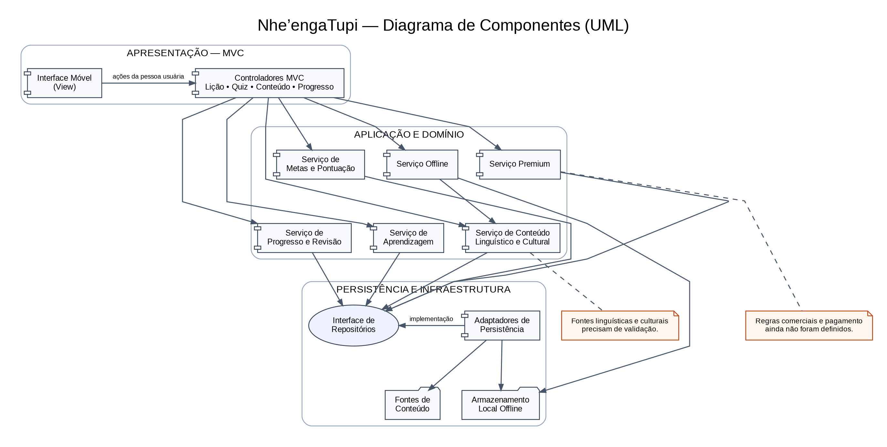
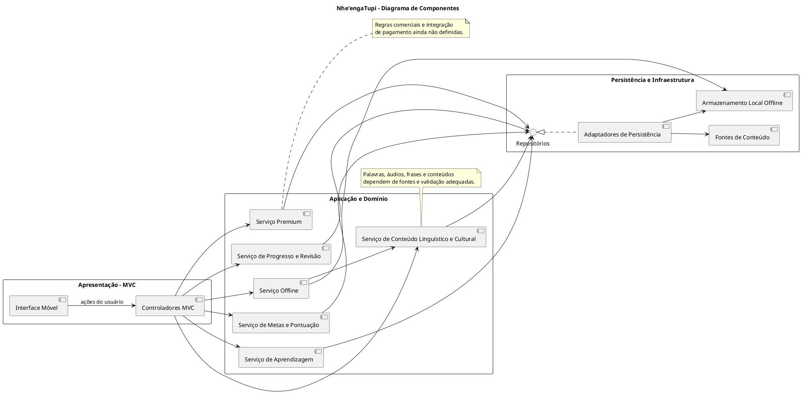

# Sprint 4

Date: 4 de fevereiro de 2025 → 15 de fevereiro de 2025
Etapa: Apresentação
Status: In progress

Apresentação da especificação dos requisitos e arquitetura moderna do **Nhe’engaTupi** (Resultado das 4 sprints + Diagrama de Componentes UML + Fechamento Documental).

> Arquivo-fonte PlantUML anexado: `NheengaTupi_Componentes_Sprint4.puml`

---

# Sprint 4 — Do Requisito à Arquitetura Moderna

- **Etapa:** RSD — Requisitos e Design de Software
- **Base funcional:** Backlog v2 (`US01` a `US11`) — Backlog v1 (`18 histórias`) preservado como histórico
- **Status:** Documentação elaborada para revisão e validação da equipe *(escopo estritamente documental e arquitetural; não representa implementação nem testes executados)*

## 1. Objetivo

Converter as User Stories do Backlog v2 em uma proposta de arquitetura de software por meio de: (1) refinamento pelo critério INVEST, (2) agrupamento semântico em domínios, (3) mapeamento de componentes e escolha justificada do estilo arquitetural, e (4) Diagrama UML 2.5 de Componentes (PlantUML).

---

## 2. Refinamento das User Stories (INVEST e Padrão Como / Quero / Para)

| ID | História Refinada (Como / Quero / Para) | Ponto de Atenção (Análise INVEST) |
| :--- | :--- | :--- |
| **US01** | Como estudante, quero acessar lições básicas de Tupi organizadas para aprendizagem progressiva, para estudar vocabulário e conteúdos introdutórios. | Definir estrutura da lição, estados de navegação e critérios de conclusão. |
| **US02** | Como estudante, quero responder quizzes relacionados às lições, para verificar minha compreensão e receber retorno sobre minhas respostas. | Definir banco de perguntas, alternativas, regras de correção e feedback. |
| **US03** | Como estudante, quero consultar conteúdos sobre história e cultura indígena com contexto e fontes identificadas, para ampliar meu conhecimento de forma responsável. | Delimitar curadoria, fontes confiáveis e tratamento de divergências culturais. |
| **US04** | Como estudante, quero reproduzir o áudio associado às palavras em Tupi, para ter apoio auditivo durante o estudo da pronúncia. | Depende de arquivos de áudio e validação linguística da pronúncia. |
| **US05** | Como estudante, quero visualizar meus registros de aprendizagem, para acompanhar as lições e atividades concluídas. | Separar registros de conclusão de avaliação de fluência. |
| **US06** | Como estudante, quero reabrir palavras e lições que já estudei, para revisar conteúdos e retomar minha aprendizagem. | Definir itens exibidos na revisão e regras de privacidade do histórico. |
| **US07** | Como estudante, quero baixar lições compatíveis com uso offline, para estudar mesmo quando estiver sem conexão. | Definir formatos, tamanho, atualização, remoção e controle de disponibilidade. |
| **US08** | Como estudante, quero acompanhar pontos e metas de estudo, para visualizar minha evolução e organizar minha rotina de aprendizagem. | Separar regras objetivas de pontuação e configuração de metas sem punição. |
| **US09** | Como estudante, quero pesquisar palavras em um dicionário Tupi-Português, para consultar seus significados e informações complementares disponíveis. | Definir tratamento de variantes, acentuação, contexto e fontes. |
| **US10** | Como pessoa usuária, quero consultar os benefícios, preços e condições dos conteúdos Premium, para decidir se desejo contratar esse acesso. | Substituir termo subjetivo *"preço acessível"* por regras comerciais verificáveis. |
| **US11** | Como estudante, quero consultar frases cotidianas organizadas por categoria, para conhecer exemplos de expressões e seus contextos de uso. | Depende de validação linguística prévia das expressões e contextos. |

---

## 3. Agrupamento Semântico em Domínios Funcionais

1. **Aprendizagem e prática (`US01, US02`):** lições, módulos, perguntas, alternativas, respostas e feedback.
2. **Conteúdo linguístico e cultural (`US03, US04, US09, US11`):** conteúdo histórico/cultural, palavras, áudio, dicionário, frases, tradução, fontes e contexto.
3. **Acompanhamento e revisão (`US05, US06, US08`):** histórico de atividades, progresso, revisão, pontos e metas.
4. **Disponibilidade offline (`US07`):** download, armazenamento local, disponibilidade e remoção de lições.
5. **Acesso Premium (`US10`):** informações de preço, benefícios, condições e limites de acesso.
- *Preocupações transversais:* privacidade/LGPD, acessibilidade, segurança, desempenho e responsabilidade cultural.

---

## 4. Estilo Arquitetural e Mapeamento de Componentes

- **Estilo escolhido:** **Arquitetura em Três Camadas organizada como Monólito Modular, com MVC na Apresentação.**
- **Justificativa:** Separa interface, regras de domínio e persistência mantendo os domínios isolados dentro de uma única aplicação, evitando a sobrecarga de rede, monitoramento e transações distribuídas de microsserviços ou brokers de mensageria (não justificados pelo escopo atual).

| Camada | Componente | Responsabilidade | Interfaces Conceituais |
| :--- | :--- | :--- | :--- |
| **Apresentação (MVC)** | Interface Móvel (View) | Exibir telas e capturar ações da pessoa usuária. | `abrirLicao(id)`, `exibirResultado(res)`, `exibirProgresso()` |
| **Apresentação (MVC)** | Controladores MVC | Receber ações e encaminhar casos de uso aos serviços. | `LicaoController`, `QuizController`, `ConteudoController`, `ProgressoController` |
| **Aplicação / Domínio** | Serviço de Aprendizagem | Consultar lições e coordenar quizzes. | `listarLicoes()`, `obterLicao(id)`, `responderQuiz(resp)` |
| **Aplicação / Domínio** | Serviço de Conteúdo Linguístico/Cultural | Consultar palavras, áudios, frases e conteúdos culturais. | `buscarPalavra(termo)`, `obterAudio(id)`, `obterFrases(cat)`, `obterConteudo(id)` |
| **Aplicação / Domínio** | Serviço de Progresso e Revisão | Registrar atividades e consultar histórico privado. | `registrarAtividade(dados)`, `consultarProgresso(usr)`, `listarRevisao(usr)` |
| **Aplicação / Domínio** | Serviço Offline | Gerenciar download e disponibilidade local de lições. | `baixarLicao(id)`, `listarDisponiveis()`, `removerLicao(id)` |
| **Aplicação / Domínio** | Serviço de Metas e Pontuação | Consultar e atualizar pontos e metas configuradas. | `consultarPontos(usr)`, `atualizarMeta(usr, meta)` |
| **Aplicação / Domínio** | Serviço Premium | Exibir ofertas, benefícios, limites e regras de acesso. | `consultarOfertas()`, `consultarCondicoes()` |
| **Persistência / Infra** | Repositórios & Adaptadores | Isolar serviços do Armazenamento Local e Fontes de Conteúdo. | `salvar(dados)`, `buscarPorId(id)`, `pesquisar(termo)` |

> *Nota:* Banco de dados, linguagem, framework, provedor de pagamento e formato de áudio permanecem em aberto até definição de requisitos técnicos.

---

## 5. Diagrama de Componentes (PlantUML 2.5)

---

## 6. Cuidados Arquiteturais, Checklist e Pendências

- **Prevenção de anti-padrões:** evitar *Big Ball of Mud* (separando domínios), acoplamento direto entre UI e persistência, dependências circulares (`Apresentação -> Aplicação -> Persistência`), decisões técnicas prematuras e mensageria assíncrona desnecessária.
- **Apoio de IA:** ChatGPT (OpenAI) foi utilizado como apoio à análise textual, organização e geração de PlantUML, sujeito à revisão humana da equipe.
- **Checklist e Pendências:**
  - [x] Análise INVEST, agrupamento semântico, mapeamento de componentes, estilo arquitetural e código/imagem PlantUML elaborados.
  - [ ] Anexar arquivo `.puml` e imagem `Diagrama_Componentes_UML_Sprint4.png` na página Sprint 4 do Notion.
  - [ ] Validar formalmente com a equipe: US refinadas, domínios, diagrama, fontes linguísticas/culturais e pendências de escopo da v1.

---

# Pacote Final de Entrega — Prontidão Documental (90%)

**Objetivo:** deixar o trabalho pronto para uma entrega documental coerente, com os limites e as pendências restantes explícitos. Este pacote não substitui aprovação da equipe/docente nem comprova implementação.

## 1. O que compõe a entrega

1. [**Documento de Visão do Produto**](Tasks/Documento%20de%20Vis%C3%A3o%20do%20Produto%20c9770191d97883e4938381f8f8ed135c.md) — problema, objetivo e proposta.
2. [Entrevista + Personas — referência principal (1)](Entrevista%20+%20Personas%20%E2%80%94%20refer%C3%AAncia%20principal%20(1)%201b370191d978820eab4281de0de2faa2.md) — tratar como simulação, não como pesquisa real.
3. [Backlog do Produto — v1 (18 histórias) (1)](Backlog%20do%20Produto%20%E2%80%94%20v1%20(18%20hist%C3%B3rias)%20(1)%205c670191d9788378b3df81521529fc2b.md) — histórico preservado.
4. [Sprint 1 — User Stories Éticas (UE01–UE25) (1)](Sprint%201%20%E2%80%94%20User%20Stories%20%C3%89ticas%20(UE01%E2%80%93UE25)%20(1)%202e370191d97882e69f350149d595b1c2.md) — requisitos éticos.
5. [Sprint 2 — Backlog v2, protótipos e BDD (1)](Sprint%202%20%E2%80%94%20Backlog%20v2,%20prot%C3%B3tipos%20e%20BDD%20(1)%20b8570191d978826790d401ee5193674c.md) — escopo funcional de referência, protótipos conceituais e cenários.
6. [Matriz de Rastreabilidade — Nhe’engaTupi (1)](Matriz%20de%20Rastreabilidade%20%E2%80%94%20Nhe%E2%80%99engaTupi%20(1)%200ae70191d978830d92be816d88a17c45.md) — liga US01–US11, UE, protótipos e BDD.
7. [Apresentação do projeto](Tasks/Apresenta%C3%A7%C3%A3o%20do%20projeto%20a0f70191d9788335b33c01ec270b6430.md) — roteiro sugerido de 11 slides.
8. [Sprint 4](milestones%20(1)/Sprint%204%20b3970191d97883658c9d01ce4787919c.md) — controle de pendências.

## 2. Decisões de escopo recomendadas para esta entrega

A documentação disponível não mostra aprovação formal da equipe para as diferenças entre backlog v1 e v2. Para evitar inventar decisões, apresentar a v2 como escopo detalhado de referência desta proposta e registrar os itens abaixo como **fora da v2 / decisão pendente**, não como cancelados:

- Cadastro e login (v1 US01–US02).
- Ranking e certificado (v1 US10–US11).
- Comunidade e chatbot (v1 US12–US13).
- Acompanhamento por educador (v1 US18).
- Cobertura explícita de gramática e recompensas da v1.
- Requisitos transversais da v1: acessibilidade, segurança/LGPD, desempenho e plataformas Android/iOS.

**Não alterar a v1 nem apagar histórias:** as decisões finais precisam de validação da equipe/docente. Se a apresentação exigir uma decisão definitiva, indicar a ausência de confirmação em vez de inferir aprovação.

## 3. Verificação de qualidade — checklist de entrega

- [x]  Páginas principais identificadas e ligadas na central.
- [x]  Backlog v1 preservado como histórico e backlog v2 indicado como referência funcional detalhada.
- [x]  Relações US–UE conferidas documentalmente entre backlog v2 e matriz.
- [x]  Protótipos e BDD identificados como conceituais/especificações, não como implementação/testes executados.
- [x]  Limites metodológicos da entrevista/persona e das atas explicitados.
- [x]  Lacunas de escopo da v1 registradas para não serem perdidas.
- [ ]  Fazer a revisão visual final da apresentação e confirmar todos os links diretamente na interface antes de enviar.
- [ ]  Confirmar com docente/equipe se a entrega exige arquivo exportado, protótipo visual ou formato específico.
- [ ]  Se houver implementação real, anexar evidências verificáveis e resultados de testes; se não houver, manter o escopo como documentação/especificação.

## 4. Linguagem segura para a apresentação

Usar:

- “A proposta especifica…”
- “Os protótipos são conceituais…”
- “Os cenários BDD descrevem o comportamento esperado e não foram apresentados como testes executados.”
- “A entrevista/persona é simulada e serve para explorar hipóteses.”
- “As atas são registros documentais cuja ocorrência/detalhes não foram confirmados independentemente.”
- “A matriz é uma proposta de rastreabilidade; a aprovação formal permanece pendente.”

Evitar:

- “O aplicativo foi desenvolvido/implementado” sem evidência.
- “Os testes passaram” sem registro de execução.
- “Os usuários validaram” sem pesquisa real.
- “A equipe aprovou” sem registro de decisão.

## 5. Roteiro curto para demonstrar o trabalho

1. Problema, objetivo e público-alvo.
2. Visão do produto e necessidades consideradas.
3. Backlog v1 versus v2: evolução documentada e lacunas ainda abertas.
4. Requisitos éticos e requisitos não funcionais.
5. Protótipos conceituais e exemplos BDD.
6. Matriz de rastreabilidade e critérios de aceitação.
7. Limitações, decisões pendentes e próximos passos.

## 6. Critério de prontidão

Considerar a entrega documental pronta para submissão quando os links estiverem conferidos, a apresentação visual revisada e o formato exigido pela disciplina confirmado. A prontidão documental não equivale a produto implementado, testado ou validado por usuários.

## 7. Controle de Fechamento (Sprint 4 — Atualização Consolidada)

- [x] Preservar Backlog v1 (18 histórias) como histórico e adotar Backlog v2 (11 histórias) como escopo funcional de referência.
- [x] Conferir consistência dos vínculos `US × UE` entre Backlog v2, Matriz de Rastreabilidade e Sprint 4.
- [x] Distinguir protótipos conceituais, entrevistas simuladas e cenários BDD propostos de implementações ou testes executados.
- [x] Consolidar arquitetura em 3 camadas (Monólito Modular / MVC) e Diagrama de Componentes UML na Sprint 4.
- [ ] Conferir links e anexos visuais diretamente na interface do Notion antes da submissão final.
- [ ] Confirmar com equipe/docente o formato final de entrega exigido.
